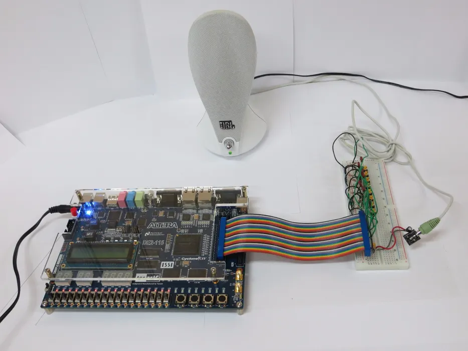
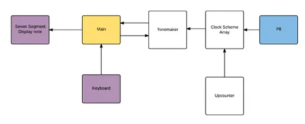
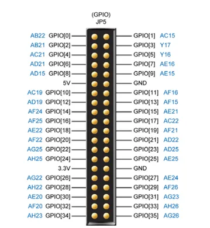
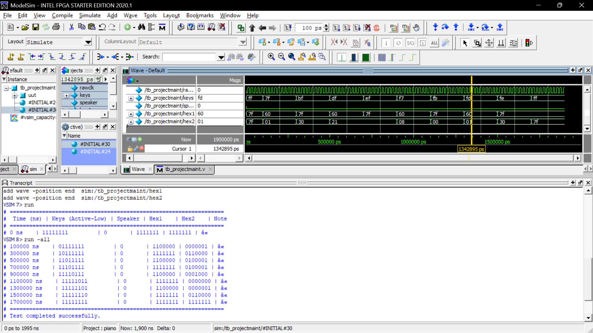

# Blues Piano on the Terasic DE2-115 FPGA Board

An eight-key piano that plays the notes of a **D-flat blues scale**, written in **Verilog HDL** for the Terasic **DE2-115** (Altera Cyclone IV E) development board. The note being played is shown on two on-board seven-segment displays, and the sound is a square wave sent to a speaker through an audio jack.

> **Course:** Digital System Design with FPGA (MAVLD503) – Lab-8, 9, 10 | Fall Semester 2025–2026 | Slot: L25 + L26
> **Based on:** [Blues Piano Using Terasic DE2-115 Development Board (Instructables)](https://www.instructables.com/Blues-Piano-Using-Terasic-DE2-115-Development-Boar/)



## Features

- Eight push-button keys: D♭, E, G♭, G, A♭, B, and upper-octave D♭ and E
- Priority encoder, so only one note plays at a time
- Notes generated from PLL clocks divided by 32-bit up-counters
- Note letter and flat sign shown on HEX1 / HEX0 of the board
- Testbench with a ModelSim simulation of all eight keys

## Architecture



| Module | Function |
|---|---|
| `projectmaint` (Main) | Top level. Inverts the active-low keys and connects the other modules. |
| `keyboard` | Priority encoder: 8 keys to a 4-bit note code (15 = no key). |
| `tonemaker` | Selects a bit of a divided clock based on the note code and drives the speaker. |
| `clockschemearray` | Feeds the PLL clocks into six 32-bit up-counters. |
| `upcounter32` | 32-bit binary counter used as a frequency divider. |
| `sevsegdisplaynote` | Decodes the note code into seven-segment patterns. |
| `pll`, `pll2` | Quartus PLL megafunctions (IP), generated in Quartus. |

### Key-to-note mapping

| Key | Note | Speaker source |
|---|---|---|
| `keys[7]` (highest priority) | D♭ | `clkarray0[15]` |
| `keys[6]` | E | `clkarray1[15]` |
| `keys[5]` | G♭ | `clkarray2[15]` |
| `keys[4]` | G | `clkarray3[15]` |
| `keys[3]` | A♭ | `clkarray4[15]` |
| `keys[2]` | B | `clkarray5[15]` |
| `keys[1]` | D♭ (octave up) | `clkarray0[14]` |
| `keys[0]` (lowest priority) | E (octave up) | `clkarray1[14]` |

## Repository structure

```
blues-piano-de2-115/
├── src/
│   └── projectmaint.v          # Design (all modules)
├── tb/
│   └── tb_projectmaint.v       # Testbench
├── constraints/
│   └── piano.tcl               # Quartus pin-assignment script
├── docs/
│   ├── Blues_Piano_Lab_Report.docx
│   └── images/
├── .gitignore
└── README.md
```

> **Note:** `pll` and `pll2` are Quartus IP files and are not part of `projectmaint.v`. Generate them with the Quartus IP Catalog (ALTPLL) and place the resulting `.v` / `.qip` files in `src/`.

## Hardware

- DE2-115 board with a 40-pin ribbon cable to a breadboard
- Eight push-button switches, eight 2 kΩ resistors, eight 0.022 µF capacitors (optional), one or two 10 µF capacitors
- Audio jack and speaker

### Pin assignment

| Signal | FPGA pin | Board connection |
|---|---|---|
| `rawclk` | PIN_Y2 | CLOCK_50 |
| `keys[7:0]` | Y16, AE16, AE15, AF16, AF15, AE21, AC22, AF21 | GPIO[5, 7, 9, 11, 13, 15, 17, 19] |
| `speaker` | PIN_AE25 | GPIO[25] |
| `hex1[6:0]` | G18, F22, E17, L26, L25, J22, H22 | HEX0 (flat sign) |
| `hex2[6:0]` | M24, Y22, W21, W22, W25, U23, U24 | HEX1 (note letter) |



## How to run

### Simulation (ModelSim)

```
vlog src/*.v tb/tb_projectmaint.v
vsim work.tb_projectmaint
add wave sim:/tb_projectmaint/*
run -all
```

The testbench presses each key in turn and prints the key state, speaker output and both display outputs. It ends with `Test completed successfully.`



### Hardware (Quartus Prime)

1. Create a Quartus project for the **Cyclone IV E EP4CE115F29C7** device with `projectmaint` as the top-level entity, and add the files from `src/`, including the PLL IP.
2. Open `constraints/piano.tcl` and set `PROJECT_NAME` to your project name.
3. Run the script (**Tools → Tcl Scripts**, or `quartus_sh -t constraints/piano.tcl`).
4. Compile the project and program the board through **Tools → Programmer** (USB-Blaster).
5. Connect the keyboard and speaker as in the hardware section and press the keys.

## Results

The Video capture screenshots display the outputs on the Seven Segment displays for the respective input through push buttons on the breadboard.

## Authors

| Name | Reg. No. |
|---|---|
| Spandan Bhaduri | 26MVD0062 |
| Pulavarti Yogesh | 26MVD0064 |
| Chinmayananda R Sharma | 26MVD0080 |

Submitted to: Dr. Jagannadha Naidu K

## Reference

- [Blues Piano Using Terasic DE2-115 Development Board – Instructables](https://www.instructables.com/Blues-Piano-Using-Terasic-DE2-115-Development-Boar/)
